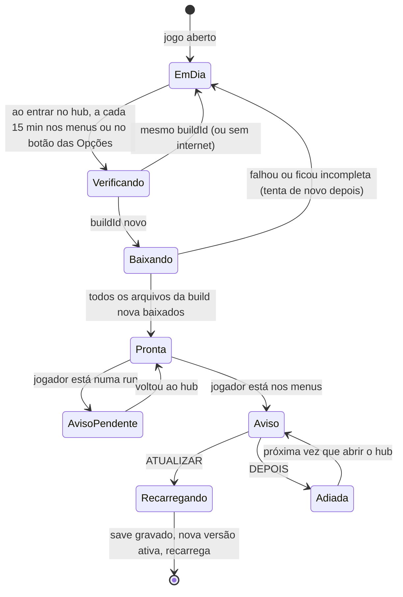

# Jogo offline e atualizações

Como o jogo chega ao aparelho, como funciona sem internet e como uma versão nova substitui a antiga sem atrapalhar quem está jogando. É a [fase 2.5 do roadmap](roadmap.md#fase-25-jogo-offline-e-atualizações-controladas) e a [decisão 0016](decisoes/0016-offline-e-atualizacoes.md).

## Regras

1. **O jogo inteiro fica no aparelho.** Depois do primeiro acesso, todo o código, as texturas e as fontes estão guardados no navegador. Sem internet, o jogo abre e roda igual.
2. **Nada muda sozinho na tela.** Internet caindo, oscilando ou voltando, ou uma versão nova publicada no meio da partida: a tela não recarrega e o jogo não para.
3. **Só build completa.** O aparelho só troca de versão por uma build inteira e já publicada. Arquivo solto, build pela metade ou publicação em andamento nunca chegam ao jogador.
4. **A troca é sempre do jogador.** A versão nova é baixada em segundo plano e só entra quando o jogador aceita o aviso ou recarrega o site.
5. **Aviso só nos menus.** Se o jogo descobre uma versão nova durante uma run, guarda o aviso e mostra quando o jogador voltar ao hub. Nunca durante a run, a pausa ou o level up.
6. **O save sobrevive.** A versão nova lê o save da antiga ([decisão 0005](decisoes/0005-save-local-indexeddb.md)); trocar de versão nunca apaga progresso.

## As peças

| Peça | O que faz | Onde fica |
| --- | --- | --- |
| Build | Pacote de uma versão: `index.html`, os arquivos com hash no nome, o `sw.js` e o `version.json` | `dist/` gerado pelo `npm run build` |
| `version.json` | Identidade da build: `version` (do `package.json`), `buildId` (hash do git + data) e a lista de arquivos com hash | Raiz da build, sempre pedido sem cache |
| Service worker (`sw.js`) | Guarda todos os arquivos da build no aparelho (precache) e responde do cache, com ou sem internet | Gerado pelo `vite-plugin-pwa` (Workbox), modo `prompt` |
| Gestor de atualização | Código do jogo que pergunta se há build nova, acompanha o download e decide quando avisar | `src/game/update/` |
| Aviso de atualização | Popup no hub: "Nova versão pronta" com ATUALIZAR e DEPOIS | Cena de interface, só nos menus |
| Verificar atualização | Botão nas Opções que procura build nova na hora e mostra o estado | Tela de Opções |
| Publicador | Script que gera a build e a publica de forma atômica | `npm run release` (`tools/release/`) |

## Ciclo de uma atualização



- **Verificar** é um pedido pequeno do `version.json`, sem cache. Sem internet ou com erro, nada acontece: o jogo segue na versão que tem.
- **Baixar** é o service worker novo se instalando em segundo plano. Ele só termina a instalação se todos os arquivos da lista vierem certos; se faltar um, a instalação é descartada e a versão antiga continua.
- **Pronta** quer dizer que a versão nova está inteira no aparelho, esperando. A antiga continua ativa até o jogador aceitar.
- **ATUALIZAR** grava o save, manda o service worker novo assumir e recarrega a página. **DEPOIS** fecha o aviso; ele volta na próxima entrada no hub. Recarregar o site por conta própria também ativa a versão pronta.

## Gerar uma versão e publicar

Uma versão é uma tag `vX.Y.Z` ([decisão 0017](decisoes/0017-deploy-por-versao.md)):

```
npm version minor          # ou patch / major: sobe o package.json, faz o commit e cria a tag
git push --follow-tags     # envia o commit e a tag
```

A tag dispara o workflow [deploy.yml](../.github/workflows/deploy.yml): check completo, build e publicação no GitHub Pages (`https://vstahelin.github.io/Dopamine/`), onde o jogo roda ([decisão 0018](decisoes/0018-jogo-no-pages-servidor-futuro.md)). Commits comuns na `main` só passam pelo CI. O Pages troca a build inteira de uma vez, então nunca servem uma versão pela metade; a partir daí, o gestor de atualização de cada aparelho segue as regras acima.

## Publicar uma build localmente (o gestor de build)

O site só oferece builds completas porque a publicação é atômica:

1. `npm run release` roda `npm run check` (lint, formatação, testes e build). Se algo falhar, nada é publicado.
2. A build ganha `version.json` com `version`, `buildId` e a lista de arquivos.
3. Os arquivos com hash no nome são copiados primeiro. Eles nunca colidem com os da versão anterior, que continuam lá.
4. Por último entram `sw.js`, `index.html` e `version.json`. Só aí um aparelho consegue ver a build nova.
5. As builds antigas ficam por algum tempo (as 3 últimas), para quem ainda está nelas carregar algum arquivo que faltou.

Enquanto o jogo roda só localmente ([decisão 0011](decisoes/0011-rodar-localmente.md)), "publicar" é copiar a build inteira para `releases/<buildId>`, marcá-la como completa (arquivo `.complete`, gravado por último) e só então trocar o ponteiro `releases/current.json`. O servidor local (`npm run serve`) lê o ponteiro a cada pedido e ignora builds sem o marcador. Quando a distribuição for decidida (fase 6), o mesmo passo a passo vale para o host escolhido.

## Desenvolvimento e teste

| Comando | Para quê | Atualiza a tela sozinho? |
| --- | --- | --- |
| `npm run dev` | Programar no PC, com recarga automática | Sim (só em desenvolvimento, sem service worker) |
| `npm run release` | Gerar e publicar uma build localmente, em `releases/` | — |
| `npm run serve` | Servir a build publicada localmente, em HTTPS, para testar o ciclo de atualização no PC | Não: segue estas regras |

- **HTTPS no celular.** O service worker só funciona em contexto seguro e o Chrome não o registra com certificado autoassinado. Por isso o teste no celular é pelo GitHub Pages, que tem HTTPS de verdade. O `npm run serve` (HTTPS com certificado local) serve para o PC: no navegador, `localhost` já é contexto seguro.
- **Fontes locais.** Pixelify Sans e Silkscreen entram no pacote do jogo (pacotes `@fontsource`), sem depender do Google Fonts.
- **Armazenamento persistente.** O jogo pede `navigator.storage.persist()` para o navegador não apagar o cache e o save quando o aparelho fica sem espaço.

## Na tela

- **Hub:** quando há versão pronta, o aviso aparece por cima, no estilo dos outros popups (moldura de madeira, ATUALIZAR em madeira, DEPOIS em azul): "Nova versão pronta · v0.3.0 · Sua partida e seus recordes continuam salvos."
- **Opções:** linha "VERSÃO v0.2.0 · build a1b2c3d" e o botão VERIFICAR ATUALIZAÇÃO, que mostra o estado: EM DIA, PROCURANDO, BAIXANDO, PRONTA (vira ATUALIZAR AGORA), SEM INTERNET.
- **Tela de título:** a versão no rodapé.
- **Run:** nada. No máximo um ponto discreto no botão de pausa quando há versão pronta.

## O que falta decidir

- Intervalo da verificação automática nos menus: 15 minutos está bom?
- O aviso pode ter um "não mostrar até a próxima versão", ou sempre volta ao abrir o hub?
- O GitHub Pages não deixa configurar cabeçalhos de cache; ele usa cache curto (10 minutos). O jogo pede `version.json` sem cache e o service worker confere o `sw.js`, então no pior caso o aviso de versão nova chega com até 10 minutos de atraso no Pages.
