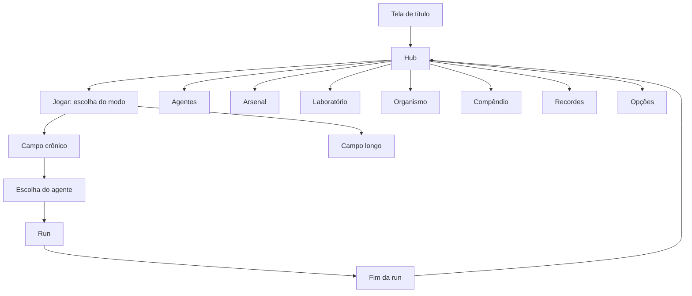

# Menu principal

Esqueleto do menu principal: as telas que o jogo vai ter, como se navega entre elas e o que cada uma mostra. Na [fase 1.5 do roadmap](roadmap.md#fase-15-menu-principal-esqueleto) o esqueleto inteiro entra no jogo, com as telas que ainda não têm conteúdo como **placeholder**: o lugar já existe, mostra o que vai ter ali e em que fase chega. Cada fase seguinte preenche a sua tela, sem mexer na navegação.

Tudo aqui é **proposta**: nomes, ordem e agrupamento podem mudar.

## Mapa das telas



## Telas

| Tela | O que tem | Hoje | Ganha conteúdo na |
| --- | --- | --- | --- |
| Tela de título | Logo e "toque para começar" | Existe (o menu atual) | 1.5 |
| Hub | Centro do menu: moeda, indivíduo, agente atual, botão Jogar e as seções | Novo | 1.5 |
| Jogar | Escolha do modo: campo crônico, campo longo | Novo | 1.5 (crônico), 4 (longo) |
| Escolha do agente | Agente da run, com ação, especial e efetividade | Placeholder (só a Dopamina) | 2 |
| Agentes | Elenco da run e do idle, detalhes e desbloqueio | Placeholder | 2 e 3 |
| Arsenal | Armas, níveis, evoluções e reagentes | Placeholder | 2 e 3 |
| Laboratório | Árvores de upgrades permanentes: run e idle | Placeholder | 3 e 4 |
| Organismo | Indivíduo atual, os 4 setores de saúde, reset | Placeholder | 5 |
| Compêndio | Moléculas inimigas, modificadores e raridades já vistos | Placeholder | 2 em diante |
| Recordes | Melhor tempo, nível, decompostas, runs | Existe | — |
| Opções | FPS, tela cheia; volume com o som | Existe | 6 (volume) |

### Tela de título

O menu atual vira a tela de título: logo DOPAMINA / BLASTER e um botão grande que leva ao hub. Serve de abertura e de lugar para a versão do jogo.

### Hub

A tela onde o jogador passa entre as runs. Pensada primeiro para o celular em pé:

```
┌───────────────────────────┐
│ ATP 1.250        INDIV. 1 │  topo: moeda e indivíduo atual
│ ▮▮▮ ▮▮▯ ▮▯▯ ▮▮▮           │  4 setores de saúde (mini barras)
├───────────────────────────┤
│                           │
│      [sprite do agente]   │  agente escolhido, em destaque
│         DOPAMINA          │
│                           │
│  ┌─────────────────────┐  │
│  │        JOGAR        │  │  botão principal
│  └─────────────────────┘  │
├───────────────────────────┤
│ ┌───────┐ ┌───────┐ ┌───────┐
│ │AGENTES│ │ARSENAL│ │ LAB.  │  seções em grade (2 linhas de 3)
│ └───────┘ └───────┘ └───────┘
│ ┌───────┐ ┌───────┐ ┌───────┐
│ │ORGAN. │ │COMPÊN.│ │RECORD.│
│ └───────┘ └───────┘ └───────┘
├───────────────────────────┤
│ OPÇÕES                    │  rodapé
└───────────────────────────┘
```

- **Topo:** ATP e o indivíduo atual com os 4 setores. Enquanto não existem (fases 3 e 5), mostram valores fixos de exemplo, marcados como "em breve".
- **Agente em destaque:** o sprite do agente escolhido, maior. Tocar nele abre Agentes.
- **Jogar:** abre a escolha do modo.
- **Seções:** cada uma é um cartão com ícone e nome. Seção que ainda é placeholder aparece com um selo "EM BREVE".
- **Telas largas (PC, celular deitado):** o agente e o Jogar ficam à esquerda e a grade de seções à direita.

### Jogar: escolha do modo

Dois cartões grandes:

- **Campo crônico:** a run (mundo aberto). Leva à escolha do agente.
- **Campo longo:** o idle (campo vertical). Placeholder até a fase 4, com a explicação do modo e "EM BREVE · FASE 4".

Se o "modo aberto" da aba [Armas](armas.md) virar um modo separado, ele entra aqui como terceiro cartão.

### Escolha do agente

Lista dos agentes da run ([Personagens](personagens.md)). Cada um mostra sprite, ação, especial, efetividade por tipo e efeito na saúde. Bloqueados aparecem com cadeado e o custo. Até a fase 2, só a Dopamina está liberada; os outros aparecem bloqueados para mostrar o que vem.

### Agentes

Elenco completo, em duas abas: **Run** e **Idle**. Detalhe de cada agente (a mesma ficha da escolha) e o botão de desbloqueio (moeda + nível do agente anterior, fase 3).

### Arsenal

As armas da aba [Armas](armas.md): arquétipo, níveis, evoluções e o reagente que cada evolução pede. Armas bloqueadas com cadeado e custo. Na fase 1.5, mostra o Radical Livre liberado e as outras 6 bloqueadas.

### Laboratório

As árvores de upgrades permanentes da meta-progressão, em duas abas: **Run** (fase 3) e **Idle** (fase 4). Nome temático para "árvore de habilidades": é onde o médico pesquisa melhorias entre um tratamento e outro. Cada nó mostra o atributo, o nível e o custo em ATP.

### Organismo

O indivíduo sendo tratado: os 4 setores de saúde (física, mental, social e executiva) com o efeito de cada um no jogo, e o botão de reset para o próximo indivíduo quando liberar ([Mecânicas](mecanicas.md)). Placeholder até a fase 5.

### Compêndio

Tudo o que o jogador já encontrou: moléculas inimigas (com a cascata de decomposição), modificadores e raridades. O que ainda não foi visto aparece como silhueta. Começa a encher na fase 2.

## Placeholder

Uma tela placeholder tem sempre o mesmo formato, para ninguém achar que é um bug:

- Título da seção e ícone.
- Uma frase sobre o que vai ter ali.
- Selo "EM BREVE · FASE N".
- Quando fizer sentido, conteúdo de exemplo (por exemplo, a lista de agentes com todos bloqueados).
- Botão Voltar.

## Navegação

- Toda tela tem **Voltar** (botão e tecla Esc) que leva à tela anterior; do hub, Voltar leva à tela de título.
- Fim da run tem **Jogar de novo** (mesmo modo e agente) e **Menu** (volta ao hub).
- A pausa da run tem **Voltar ao menu** (hub).

## O que falta decidir

- Os nomes das seções (Laboratório, Compêndio, Arsenal) funcionam, ou prefere nomes diretos (Upgrades, Bestiário, Armas)?
- O hub mostra o idle rodando ao fundo (como uma janela do campo longo), ou o idle só aparece no modo Campo longo?
- A tela de título continua existindo, ou o jogo abre direto no hub?
- Conquistas entram como seção própria?
